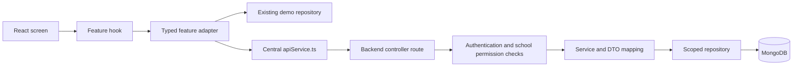

# School Management System — Project Audit and Integration Plan

Audit date: **17 October 2026 (Asia/Kolkata)**. Scope: source inspection and non-destructive verification only.

Repository shorthand used in evidence references:

- **F**: `/home/devendra/schooool`
- **B**: `/home/devendra/scholl backend/type-ORM-backend-Node`

References such as `F/src/app/router.tsx:18` identify the repository, file, and starting line. **Verified** means observed in the current source or an actual command result. **Proposed** means future work, not an existing endpoint or capability. **Unverified** means runtime behavior or deployment state could not be established. README claims and older verification documents were not treated as current test results.

## 1. Executive summary

**These repositories are not integrated, and the backend is not currently a school-management backend.** The frontend is a substantial React school-workspace prototype using seeded data and browser storage. The backend implements a different domain: user accounts, groups, wallets, money transfers, and split payments.

The frontend has working local workflows for students, staff, attendance, fees, salary, academic tests and marks, communication simulation, documents, and settings. None uses a school API. The requested `src/services/apiService.ts`, `useStudents`, `useTeachers`, `useClasses`, `useAttendance`, and `useFees` do not exist. Current reads use `useSchool()` and mutations call a synchronous repository directly.

The backend actually uses **TypeORM 0.3.21 with MongoDB repositories**, with the native `mongodb` package supplying ObjectIds and the driver. It does not use Mongoose. It has **18 active controller endpoints**, a root health-style response, and optional Swagger/monitor mounts. No school, academic-year, membership, student, teacher, class, attendance, fee, or exam model/controller exists.

School isolation is **not implemented on the server**. Existing security defects include unauthenticated account-detail changes, public group/member reads, self-selected account roles, reusable password-reset tokens, and non-atomic financial writes. These are blockers to using this backend for real school data.

Frontend type checking, linting, and **186 tests across 31 unit-test files passed**. A production build passed using temporary output paths. Backend verification is blocked by absent dependencies; no database or backend server was started. **Browser verification completed all 79 scenarios across two Chrome runs: 73 passed and 6 failed**; failures and limitations are detailed in section 10.

**Recommended first vertical slice:** an authenticated, school-scoped, read-only school profile in the existing Settings → General screen. There is no suitable existing school endpoint to connect directly. Implement the small school/membership foundation and profile read first; then student directory reads, attendance, and finance in that order. Keep both repositories separate.

## 2. Frontend technology and architecture

### Toolchain

| Area | Verified implementation |
|---|---|
| Framework | React / React DOM 19; installed React reports 19.3.0. Client-rendered SPA, not Next.js or SSR. |
| Routing | `react-router-dom` declared `^7.0.0`, installed 7.18.4; `createBrowserRouter`, lazy route components, URL search parameters. |
| Build | Vite declared `^7.0.0`, installed 7.3.7; React plugin and Tailwind Vite plugin. |
| TypeScript | Installed 5.9.3; ES2022 target, ESNext modules, bundler resolution, strict mode, unused variable/parameter checks, no emit. `tsconfig.json` covers `src` and `vite.config.ts`, not the Playwright test suite. |
| Styling / UI | Tailwind 4 plus substantial feature CSS and CSS custom properties; Radix Dialog, Lucide icons, Inter font, Recharts charts; custom shared primitives. |
| Validation | Zod 4, installed 4.6.5. Domain schemas and custom cross-record validation, controlled React forms. No React Hook Form dependency. |
| State | `useSyncExternalStore`, a module-level `DemoState`, React component state for drafts/filters/dialogs, feedback context. No Redux, Zustand, or query-cache library. |
| Tests / quality | Vitest 5.0.3; Playwright installed 1.64.0; axe integration; ESLint installed 10.12.0; Prettier check/write scripts. |
| Runtime requirement | Package engines: `^22.13.0 || ^24.0.0 || >=26.0.0`. Audit used Node 24.14.1 and npm 11.11.0. |

Evidence: `F/package.json:1`, `F/tsconfig.json:1`, `F/vite.config.ts:1`, installed package manifests, `F/vitest.config.ts:1`, `F/playwright.config.ts:1`, `F/eslint.config.js:1`.

### Entry, layout, and navigation

`index.html` loads `src/main.tsx`, which mounts StrictMode → FeedbackProvider → RouterProvider. `src/app/router.tsx:18` supplies AppShell, a route error boundary, and a Suspense loading boundary. `src/components/layout/AppShell.tsx:39` defines the main navigation; its responsive sidebar, search, help dialog, academic-year control, and notification dropdown use the same local store.

The school control navigates to Settings; it is not a school selector. The displayed principal identity is hardcoded (`AppShell.tsx:142`). The academic-year control displays the current demo year; it is not an enrollment-promotion workflow. There is no login page, register page, forgot/reset-password route, logout session implementation, auth provider, or protected-route guard. All route components are accessible without authentication.

Features are grouped under `src/features/{dashboard,students,teachers,classes,attendance,fees,academics,notifications,settings}`. Shared components include dialogs, class filters, document upload/preview, attendance tabs, and delete confirmations. `src/components/ui/Primitives.tsx` exports Button, Badge, Avatar, PageHeading, Panel, StatCard, SearchInput, EmptyState, and Modal. Business rules live mainly in `src/lib`, shared types in `src/types`, seed/restoration code in `src/mocks`.

Forms use `useState` drafts, Zod/domain validation, inline errors, feedback toasts, and discard guards (`useDraftGuard`, plus an attendance-specific router blocker). CSV/XLSX handling and PDF/PNG document generation are local utilities, not remote export services.

## 3. Frontend screens and feature inventory

**Data legend:** Every active school screen below reads **seeded/browser-persisted data**, with component-local drafts. Counts and charts are usually computed from that data rather than hardcoded totals. This does not make them backend analytics. **C/R/U/D** describes reachable UI behavior against the local demo, not durable server CRUD. A dash means absent or not applicable. All 13 concrete routes and the wildcard route are accounted for below (`F/src/app/router.tsx:26`).

### Routed screens

| Route / screen | Implemented behavior | Data and CRUD | Gaps / qualifications |
|---|---|---|---|
| `/` — DashboardPage | Student/staff attendance for selected date, seven recorded-date trend, classroom summary, absent-student list, prolonged-absence follow-up, navigation to registers/queues. | Local calculated summaries. R only. | Not a general BI backend. Historical calculations use the current roster. Missing-day/calendar and historical-enrollment rules need authoritative server definitions. Evidence: `features/dashboard/DashboardPage.tsx:24`. |
| `/students` — StudentsPage | Name/admission search, class/section/status filtering, 12-row pagination, CSV export, add/edit/delete dialogs, profile links, daily attendance badges. | Local C/R/U/D, with protected deletion when recorded receipts exist. | Entire roster loaded and filtered in memory. No API paging, request loading/error/retry, or server numbering/concurrency. Export filename contains an old school name. `StudentsPage.tsx:30`, `lib/management.ts:172`. |
| `/students/:studentId` — StudentProfilePage | Overview, attendance, fees, academics, documents tabs; identity/guardian details; edit/delete; register links; not-found state. | Local R/U/D plus linked payment/document creation. | Identity is resolved through current-year roster; no durable cross-year enrollment/history API. `StudentProfilePage.tsx:25`. |
| `/teachers` — TeachersPage | Teaching-staff directory, name/designation search, status filter, 10-row pagination, CSV export, profile links, add-staff navigation. | Local R; C/U through Staff & HR. | No reachable teacher-delete control here. The old TeacherDialog is disconnected. Directory is derived from unified staff data, not solely `state.teachers`. `TeachersPage.tsx:19`. |
| `/teachers/:teacherId` — TeacherProfilePage | Overview/details/photo, monthly staff attendance summary, documents tab, missing-teacher state. | Local R; document C/R/D. | No dedicated salary or academic-assignment editor on this profile. `TeacherProfilePage.tsx:13`. |
| `/staff` — StaffHRPage | All Staff / Attendance / Leave tabs; add/edit staff, departments and staff filters, pagination, teaching designation, contact/salary/photo fields; leave summaries from attendance. | Local C/R/U; inactive status. No general staff D exposed. | Leave is counted from absence records, not request/approval workflow. `?tab=Salary` redirects to Finance salary tab. `StaffHRPage.tsx:24`, `StaffDialog.tsx:16`. |
| `/classes` — ClassesPage | Search grade/teacher, class/section cards, class teacher, student counts, attendance summary, directory/register links. | Local R here; structural C/U/D in Settings. | Relies on full roster and teacher arrays; no server summaries. Not in the main sidebar list, but reachable by links/direct URL. `ClassesPage.tsx:9`. |
| `/attendance` — AttendancePage | Date/class/section registers; present/absent/late/half-day/unmarked, bulk marking, draft save, unsaved-navigation protection, working-hours context, notification review. | Local C/R/U; unmarked clears marking semantically, no register-delete API. | No concurrent-edit revision, device integration, or server permissions. Save rules hardcode the demo school ID and a minimum date in `lib/operations.ts:8`. `AttendancePage.tsx:28`. |
| `/attendance/staff` — StaffAttendancePage | Date/department/staff filters, active/joined staff eligibility, marking, draft guard; feeds leave and payroll calculations. Also embedded in Staff & HR. | Local C/R/U. | No leave approval, time-clock ingestion, or authoritative payroll closing. `StaffAttendancePage.tsx:37`. |
| `/fees` — FinanceWorkspace | Overview / Student Fees / Salary Expenses / Transactions tabs; period summaries, student dues, salary ledger, combined transaction filters, CSV export, generated documents. | Local R plus payment C and fee-plan U through child screens. | No gateway, reconciliation, transaction reversal, or server financial ledger. `FinanceWorkspace.tsx:29`. |
| `/academics` — AcademicsPage | Tests and Results views; class/section scope, manual test types, multi-class/section tests, test creation/edit/delete, marks sheets, result summaries/rankings, student-history links. | Local test C/R/U/D; marks C/R/U, removed with test deletion. | No frozen exam roster, durable revisions, server grading, or report-release authorization. Current forms/marks sheets differ from older disconnected components. `AcademicsPage.tsx:44`, `MarksDialog.tsx:30`, `ResultsView.tsx:29`. |
| `/notifications` — CommunicationWorkspace | Overview queue / Compose Notice / History; event/audience filters, contact/channel eligibility, preview, demo dispatch/retry, schedules/cancellation, outcome history. | Local C/R/U and cancellation; no general history D. | “Delivered” and “Failed” are simulation outcomes; scheduled processing runs in browser reconciliation, not a server worker. `CommunicationWorkspace.tsx:17`, `CommunicationQueue.tsx:245`, `lib/communication.ts`. |
| `/settings` — SettingsPage | Nine settings tabs detailed below. | Local settings R/U plus selected configuration C/D. | Roles, login/session, and backup controls do not enforce real access/security. `SettingsPage.tsx:15`. |
| `*` — not found | Unknown route message and return link. | No data operation. | Route exception UI is separate from an API request failure state. |

### Embedded workflows and settings

| Screen / location | Actual implementation and CRUD | Missing / incomplete |
|---|---|---|
| Student attendance tab | Monthly attendance display and summaries; R. | No independent server history. |
| Student fees tab / Finance Student Fees | Fee-plan editor, one-time/installment schedules, progress and due states, payment history, payment recording, allocation, receipts. Plans C/R/U; payments C/R. | No payment U/D/refund. Money represented in integer paise by frontend validation; no payment collection transport. `StudentFees.tsx`, `FeePlanEditor.tsx`, `PaymentDialog.tsx:46`, `lib/financeTransactions.ts`. |
| Finance Salary Expenses | Staff cycle calculations, net salary, payment recording/history, salary-slip preview/download. C/R payments. | No bank payout, payment reversal, approval, or server idempotency. `teachers/StaffPage.tsx`, `SalaryPaymentDialog.tsx`. |
| Finance Transactions | Combined fee and salary entries, filtering, 20-row pagination, export, receipt/slip viewing. R. | Browser-derived ledger only. |
| Academic marks sheet | Numeric scores, A for absent, blank/pending handling, per-section drafts, maxima, CSV/XLSX templates and preview/import, validated save/discard. C/R/U. | Remote revision and roster reconciliation absent. `MarksDialog.tsx:99`, `lib/academicSheets.ts`, `lib/sheetImport.ts`. |
| Student academics / result preview | Test history, subject details, rank/percentage views, manage-marks navigation, report text preview and sharing. R; links to marks U. | A WhatsApp `wa.me` link is a user-initiated external compose link, not verified delivery. Report preview/copy works locally. `StudentAcademics.tsx`, `ShareReportDialog.tsx`, `lib/reportShare.ts:81`. |
| Student / teacher documents | Category selection, file validation, upload/read/download/delete; student and staff ownership. C/R/D. | No document replacement/metadata U workflow identified. Data URLs persist in browser storage. Upload checks allow PDF/PNG/JPEG/WebP up to 2 MB; there is no protected server object store or scanning. `components/shared/EntityDocuments.tsx`, `lib/fileUploads.ts:21`, `lib/entityDocuments.ts:45`. |
| Settings → General | Identity/contact/board/principal/logo editing, academic-year display, school opening/closing/working days. R/U. | No school creation/switching or year provisioning. `SchoolProfile.tsx:30`. |
| Settings → Classes, Sections & Grades | Class and section C/R/U/D, deletion guards, subject setup/aliases/archive, section student modal/list, add/edit/delete student and XLSX import/preview. | No promotion/transfer history or annual class management. `ClassStructureSettings.tsx:17`, `ClassSubjectsSettings.tsx`, `ClassStudents.tsx`, `StudentImportDialog.tsx`. |
| Settings → Attendance | Times, grace/thresholds, notification and eligibility settings, validated local edits. R/U. | Configuration values are not evidence of automated biometric, SMS, or server enforcement. |
| Settings → Staff & Payroll | Department/designation C/R/U/D, work/leave/payroll settings, salary configuration. | No durable policy versioning, payroll approvals, or payment provider. |
| Settings → Communication | Channel toggles, event templates, defaults/rules and local validation. R/U. | “Demo connected” labels are explicit; no provider credentials or transport. `CommunicationSettings.tsx:43`. |
| Settings → Roles & Permissions | Staff role matrix, custom role C/R/U/D with built-in constraints; loginAllowed toggle and assigned-section access preview. | No actual account creation, invitation, password, session, or route enforcement. Student/guardian login is expressly excluded. `RolesPermissionsSettings.tsx:216`, `StaffAccessDialog.tsx:35`, `lib/staffAccess.ts:25`. |
| Settings → Templates | Six receipt/slip designs, accents, logo/header/footer/signature/stamp assets, live preview, save. R/U. | Generated documents use current presentation settings; no server-issued immutable receipt archive. `TemplatesSettings.tsx`, `lib/documentRendering.ts`, `lib/recordedDocuments.ts`. |
| Settings → Data & Security | Real CSV/XLSX exports of local data; local activity list. Backup/restore/password/logout-device dialogs are previews. | Backup only updates status/time; restore does not restore records; password preview does not change credentials; sample session logout is not authentication. `DataSecuritySettings.tsx:35,151,234`. |
| Settings → Preferences | English/Hindi navigation/date preferences, date/time format, week start, landing page, current academic year. R/U. | Partial localization, fixed INR/Indian number display, only one year option. `PreferencesSettings.tsx:32,84`. |
| Header utilities | Student search navigation, notification attention dropdown, academic-year information, help. | No authenticated account menu or multi-school selection. `AppShell.tsx`, `TopbarControls.tsx`. |

### Existing code that is not an active screen

A relative-import reachability scan from `src/main.tsx`, checked against actual imports, found these feature files disconnected from the running application:

- `src/features/teachers/TeacherDialog.tsx` — older teacher management form.
- `src/features/notifications/NotificationsPage.tsx` and `NotificationPreview.tsx` — older notification flow.
- `src/features/academics/ImportMarksDialog.tsx` and `TestAbsences.tsx` — older dedicated import/absence UI. Current MarksDialog implements imports, and communication has test-related events, but the dedicated TestAbsences component is not rendered.
- `src/features/settings/TimetableSettings.tsx`, `StudentTimings.tsx`, `StudentTimingDialog.tsx`, and `src/features/classes/ClassTimetableDialog.tsx` — timing/timetable editors exist but are not mounted. General settings currently exposes school hours instead.

Repository methods and domain tests for these older capabilities still exist. Do not advertise a reachable timetable screen or teacher-deletion UI based on those files alone. Authentication screens, parent portal, school onboarding, subscriptions, and school/year switching are absent.

## 4. Frontend API and mock-data status

### Current flow

```text
route component → useSchool() → repository.getSnapshot() → DemoState
dialog/save handler → repository mutation → pure domain operation
                    → localStorage persistence → subscriber notification → render
```

`F/src/app/useSchool.ts:3` subscribes to the whole snapshot. `F/src/lib/repository.ts:200` defines the synchronous interface; `:273` creates seed data and restores storage; `:319` persists before replacing the in-memory snapshot; `:369` defines mutations. `F/src/lib/config.ts:2` contains a fixed school ID and a single storage key.

Verified data behavior:

- `src/mocks/seed.ts:47` constructs the fictional school, current academic context, roster, attendance, fees, and results. IDs include human-readable seed strings; new records commonly use `crypto.randomUUID()`.
- Restoration validates and merges persisted data. Incompatible/unavailable storage silently starts a fresh demo (`repository.ts:288`); a failed explicit save surfaces an error and leaves the previous snapshot intact (`:360`).
- Day/focus refresh can merge newly generated attendance and reconcile communication (`repository.ts:296`). This must never run against an API-backed production dataset.
- Shared types are domain snapshots, not HTTP response contracts: `src/types/domain.ts`, `ledger.ts`, `communication.ts`, `staffAccess.ts`, `admin.ts`.
- There is no `src/services/apiService.ts`, services HTTP adapter, API base URL, `fetch`/Axios transport in application source, or feature data hook matching the requested names. No API request mocking framework is in use. Local image/font requests and explicit WhatsApp links are separate from business API calls.

### States and architectural deviations

| Concern | Current state | Integration change needed |
|---|---|---|
| Read loading | Suspense covers downloading route code. Local data is synchronously present. | Add request loading and stale/refetch indicators to feature hooks. |
| Read errors | Route error boundary and missing-record/empty states; no HTTP error states. | Per-feature error, retry, cancellation and access-denied handling. |
| Mutation errors/success | Inline validation/storage errors and synchronous success toasts. | Await confirmed writes, pending controls, preserve failed drafts, normalize server field errors. |
| Pagination/filtering | In-memory full-array search, sort, and slicing. | Server query params, bounded pagination, totals, stable ordering, export-all semantics. |
| Mutations | Components import repository directly, often then read the new snapshot immediately. | Move async orchestration behind feature hooks; return created record IDs/documents from responses. |
| Cross-feature consistency | One local snapshot updates everything immediately. | Explicit invalidation/refetch for profiles, registers, dashboards, fees, and communication. |
| Persistence | Entire demo state and file data in one localStorage entry. | Keep demo storage isolated; no implicit production persistence or fallback. |
| Identity/context | Fixed school, principal and year; some local functions hardcode school/date. | Authenticated context and server-owned tenant/permission enforcement. |

The UI and pure formatting/validation helpers are reusable, but **this is not a one-file HTTP swap**. Existing mutation methods return `void` or immediate IDs, not Promises. For example, `PaymentDialog.tsx:55` records payment and immediately reads the last payment from the snapshot; `AcademicsPage.tsx:287` looks up a newly created test immediately. Those handlers need small, deliberate async changes. Preserve screen layouts and the existing external-store pattern for mock data; introduce hooks/adapters feature by feature.

## 5. Backend technology and architecture

### Startup and runtime

The application is TypeScript/CommonJS on Express 4.21.2 with `routing-controllers`, TypeDI, class-validator, class-transformer, and microframework loaders. NestJS is used for exception classes; this is **not a NestJS application bootstrap**. `.nvmrc` specifies Node 22.13.0; package engines do not enforce it. TypeScript is declared `^5.8.2` and locked at 5.8.2. Strict mode is weakened by `noImplicitAny: false` and `strictNullChecks: false`. Decorators/metadata are enabled.

`B/src/app.ts:26` bootstraps Winston → DI → subscribers → TypeORM → Express → Swagger → monitor → home. The database must initialize before Express listens. Tests skip `.listen()` when `NODE_ENV=test`. The top-level catch logs startup failures; no successful backend startup was verified.

`package.json` and `package-scripts.js` use nps:

- `npm run dev` invokes `yarn start serve`, requiring Yarn as well as installed packages.
- `npm start` goes through nps to the production `dist/app.js` command, not a development server.
- `npm run build` generates `tsconfig.build.json`, runs lint, deletes `dist`, emits into `.tmp`, copies, and deletes `.tmp`. It was not run in this audit because it mutates/deletes project artifacts.
- `cross-env` and `ncp` are used by scripts but are only present transitively in the npm lockfile, not direct dependencies.
- Database setup includes a schema-drop step. It is not a safe startup command.

### Layers and responsibilities

| Layer | Source / responsibility |
|---|---|
| Controllers / routes | Four files in `src/api/controllers`; decorator routes, body validation, calls to services, ApiResponse wrappers. No independent route registry. |
| Services | `user.service.ts`, `group.service.ts`, `wallet.service.ts`, `split-request.service.ts`: account rules, membership checks for some group mutations, balances/split settlement, serialization. |
| Repositories | Five small modules exporting `dataSource.getMongoRepository(Model)`; no school-aware repository abstraction. |
| Models | Five `@Entity` classes with `@ObjectIdColumn`, fields, indexes/listeners. Explicit ObjectId references, not relational associations. |
| DTOs / response types | `controllers/request`, `controllers/responses`; class-validator decorators and class-transformer Expose projections. Some DTOs/responses are unused remnants. |
| Auth | `src/api/middlewares/auth.middleware.ts:14`; bearer JWT lookup and user resolution, applied only on selected methods using `@UseBefore`. |
| Infrastructure | `src/loaders`, `src/env.ts`, database configs, log/security/compression/error middleware. |

The runtime loader, auth lookup, and all repository exports import **the same `ormconfig.default.ts` DataSource**. Separate `ormconfig.ts` and `ormconfig-seed.ts` also construct DataSources for CLI paths. This is duplicated configuration, but the reviewed runtime does not demonstrate two independently initialized application connections. Earlier design-document concerns should not be repeated as a verified runtime bug.

### Environment, middleware, and configuration gaps

Only `.env.example` is present in the backend checkout; `.env` and `.env.test` are absent. No secret values are reproduced here. The loader selects `.env.test` only for test mode; otherwise `.env`. `getOsEnv` throws when a required variable is undefined. Even disabled Swagger/monitor and unused email flows cause eager configuration reads.

| Group | Variable names used |
|---|---|
| Runtime/app | `NODE_ENV`, `PORT`, `APP_NAME`, `APP_PORT`, `APP_SCHEMA`, `APP_HOST`, `APP_ROUTE_PREFIX`, `APP_BANNER` |
| Authentication/email | `JWT_SECRET`, `EMAIL_USERNAME`, `EMAIL_PASSWORD`, `EMAIL_HOST`, `EMAIL_PORT`, `FROM_EMAIL`, `RESET_PASSWORD_LINK` |
| Database | `TYPEORM_CONNECTION`, `TYPEORM_HOST`, `TYPEORM_PORT`, `TYPEORM_USERNAME`, `TYPEORM_PASSWORD`, `TYPEORM_DATABASE`, `TYPEORM_DB_URL`, `TYPEORM_SYNCHRONIZE`, `TYPEORM_LOGGING`, `TYPEORM_LOGGER`, `TYPEORM_SSL` |
| Discovery/CLI paths | `TYPEORM_MIGRATIONS`, `TYPEORM_MIGRATIONS_DIR`, `TYPEORM_SEEDERS`, `TYPEORM_SEEDERS_DIR`, `TYPEORM_ENTITIES`, `TYPEORM_ENTITIES_DIR`, `CONTROLLERS`, `MIDDLEWARES`, `INTERCEPTORS`, `SUBSCRIBERS`, `SUBSCRIBERS_DIR`, `RESOLVERS` |
| Logs | `LOG_LEVEL`, `LOG_JSON`, `LOG_OUTPUT` |
| Swagger | `SWAGGER_ENABLED`, `SWAGGER_ROUTE`, `SWAGGER_USERNAME`, `SWAGGER_PASSWORD`, `SWAGGER_PORT` |
| Monitor | `MONITOR_ENABLED`, `MONITOR_ROUTE`, `MONITOR_USERNAME`, `MONITOR_PASSWORD` |

Required reads missing from `.env.example`: **`EMAIL_USERNAME`, `EMAIL_PASSWORD`, `EMAIL_HOST`, `EMAIL_PORT`, `FROM_EMAIL`, `RESET_PASSWORD_LINK`, `TYPEORM_DB_URL`, `TYPEORM_SSL`, `TYPEORM_SEEDERS_DIR`**. `JWT_SECRET` is also absent, but code silently falls back to a hardcoded signing secret instead of requiring it. Directory arrays can become empty when unset; entities/controllers/middleware may then fail to load as intended. Some DB/log settings are read but not actually passed to the active configuration. `SWAGGER_PORT` is read as required while constructing the app base URL even though another property reads it optionally.

Verified middleware/configuration (`src/loaders/expressLoader.ts:11` and `src/api/middlewares`):

- `cors: true`; no origin allowlist or credentialed-cookie configuration.
- `validation: true`, `classTransformer: true`; no explicit DTO whitelist/unknown-field rejection.
- Custom error handling, Helmet, HSTS, no-cache, compression, Morgan and Winston are defined, subject to environment middleware discovery.
- No general login/request rate limiter, school guard, permission guard, CSRF/session middleware, or audit trail. Password-reset throttling is an in-process map only.
- Swagger declares bearer auth globally in documentation; this does not enforce authentication. Swagger UI and monitor page use optional Basic Auth when usernames are configured. Monitor middleware is mounted separately, so its default paths/socket exposure need runtime review.

## 6. Backend endpoint inventory

**Route notation:** `P = APP_ROUTE_PREFIX`. Its effective deployed value is unknown. A route shown as `P/user/login` means the configured prefix followed by `/user/login`; no `/api/v1` prefix is assumed. The 18 controller methods below are active source, but none was HTTP/DB-tested in this environment. “Implemented” means a real service/database path exists, not that it is production-ready.

| Feature | HTTP method | Route | Controller/service | Authentication required | Database operation | Status |
|---|---|---|---|---|---|---|
| Register | POST | `P/user/create` | UsersController.createUser → UserService.createUser | No | Find username; save wallet; save user; link wallet | Implemented; self-selected role, multi-write orphan risk, response mapping defect |
| Login | POST | `P/user/login` | UsersController.loginUser → UserService.loginUser | No; password checked | Read user; bcrypt compare; sign JWT | Implemented; 3-hour token; user fields incorrectly projected |
| Change password | POST | `P/user/change-password` | UsersController.changePassword → UserService.changePassword | No JWT; current password checked | Find username; hash and update password | Implemented; no access-token revocation |
| Account details | POST | `P/user/update-details` | UsersController.updateDetails → UserService.updateDetails | **No** | Find body username; optional email uniqueness read; update from body | **Critical authorization defect**; role/contact changes allowed |
| Forgot password | POST | `P/user/forgot-password` | UsersController.forgotPassword → UserService.forgotPassword | No | Find matching username/email; sign token; SMTP send | Implemented; requires mail config; process-local throttle |
| Reset password | POST | `P/user/reset-password` | UsersController.resetPassword → UserService.resetPassword | Reset token in body; no bearer middleware | Verify JWT; find user; update password hash | Implemented; token consumption missing; ObjectId-only find condition needs runtime check |
| Create group | POST | `P/group/create` | GroupController.createGroup → GroupService.createGroup | Bearer JWT | Check global name; read members; save group | Implemented; creator/member checks, naming/index mismatch |
| My groups | GET | `P/group/` | GroupController.getMyGroups → GroupService.getGroupsByUser | Bearer JWT | Find by membership | Implemented; unpaginated |
| Group detail | GET | `P/group/:id` | GroupController.getGroupById → GroupService.getGroupById | **No** | Find group; fetch member users | Implemented; public member/contact disclosure |
| User's groups | GET | `P/group/user/:userId` | GroupController.getGroupsByUser → GroupService.getGroupsByUser | **No** | Find groups with supplied member ID | Implemented; public enumeration |
| Delete group | DELETE | `P/group/:id` | GroupController.deleteGroup → GroupService.deleteGroup | Bearer JWT + creator check | Read; deleteOne group | Implemented; no dependent split cleanup |
| Leave group | PATCH | `P/group/:id/leave` | GroupController.leaveGroup → GroupService.leaveGroup | Bearer JWT + membership check | Remove member; creator leaving deletes group | Implemented; no split/reference lifecycle handling |
| Edit group | PATCH | `P/group/:id` | GroupController.updateGroup → GroupService.updateGroupInfo | Bearer JWT + creator check | Read; updateOne; re-read | Implemented; cannot clear description with empty string |
| Group members | PATCH | `P/group/:id/members` | GroupController.updateGroupMembers → GroupService.updateGroupMembers | Bearer JWT + creator check | Read users/group; set members; re-read | Implemented; retains creator, no revision control |
| Send money | POST | `P/wallet/send` | WalletController.sendMoney → WalletService.sendMoney | Bearer JWT | Read users/wallets; save transaction and both wallets | Implemented; non-atomic, no idempotency/self-transfer guard |
| Initiate split | POST | `P/split/initiate/:groupId` | SplitRequestController.initiate → SplitRequestService.initiateSplit | Bearer JWT + group participant check | Read group/recipient/wallet; save split | Implemented; amount not constrained positive; no debit/reservation at initiation |
| Accept split | POST | `P/split/accept/:splitRequestId` | SplitRequestController.accept → SplitRequestService.acceptSplit | Bearer JWT + participant/state checks | Update accepted list; when complete, save transactions/wallets/split | Implemented; partial settlement and race risks |
| Reject split | POST | `P/split/reject/:splitRequestId` | SplitRequestController.reject → SplitRequestService.rejectSplit | Bearer JWT + participant/state checks | Debit initiator full amount, credit recipient, save transaction/split | Implemented; rejection triggers payment, non-atomic |
| Home | GET | `P` | `homeLoader` | No | None | Returns `{ message: 'App is working' }`; not a standalone DB health check |
| Swagger UI/assets | USE / typically GET | `SWAGGER_ROUTE` | `swaggerLoader` / swagger-ui-express | Optional Basic Auth | None | Conditional; OpenAPI bearer annotation is documentation only |
| Status monitor | GET + package middleware | `MONITOR_ROUTE`; package default routes need verification | `monitorLoader` / express-status-monitor | Optional Basic Auth on configured page | None | Conditional; full middleware/socket surface unverified without installed runtime |

Controller evidence: `B/src/api/controllers/user.controller.ts:26`, `group.controller.ts:27`, `wallet.controller.ts:19`, `split-request.controller.ts:17`. Infrastructure evidence: `B/src/loaders/homeLoader.ts:9`, `swaggerLoader.ts:54`, `monitorLoader.ts:14`.

`GET /wallet/me` and `GET /wallet/transactions` are **commented out**, not endpoints. No student/class/fee CRUD should be inferred from wallet or group routes. `RegisterUserDto` does not establish an extra registration route.

### Requests, responses, filtering, and errors

| Feature | Actual request validation | Response / query behavior / gaps |
|---|---|---|
| Users | Create requires username, role enum, nonempty password, UPI ID, 10-digit phone; email optional. Login requires username/password. Change requires username/current/new/confirm passwords. Update requires username/role/phone (despite optional TS phone property), email optional. Forgot requires username/email; reset requires token/new/confirm password. | No school membership data. No password-length/strength rules. No user listing/profile/me/logout/refresh routes. UserResponse exposes `id,name` but receives `_id,username`; LoginResponse expects flattened fields but service passes `{ user, token }`. Token is mapped; user identity fields are not mapped as intended. Change/update controllers discard service data and return `data:null`; forgot/reset projections also do not match supplied payloads. |
| Groups | Create nonempty name; optional description and string-per-member validation, but no `IsArray` for create members. Update name/description optional. Add/remove arrays validated as arrays of strings. | ObjectId path/body format validation missing. Lists return all matched groups, without pagination, sort, search, or cap. Detail returns populated member objects while declared response says `string[]`; other group responses return IDs. Create checks name globally, but declared `(name,createdBy)` index is not unique; update does not check duplicate name. |
| Wallet | `toUpiId` nonempty string; amount numeric and at least 1. | Transaction DTO uses string IDs and timestamp; currency/minor unit undocumented, decimals allowed. No history/balance endpoint active; no filter/paging/export. No real banking/UPI provider request occurs. |
| Splits | amount is nonempty numeric; destination UPI string. No positive/minor-unit constraint. Accept/reject use path ID. | Split DTO includes IDs, members/accepted/rejected, status/date/recipient. No list/get/history/cancel endpoint, pagination, expiration, reservation, or rounding policy. |

Normal controller results use `{ status, data, message, error }` (`controllers/responses/api.response.ts:1`). Caught service exceptions become an ApiResponse object without setting Express HTTP status or throwing; a failure can therefore be an HTTP success with `status:4xx/5xx` in JSON. Validation middleware sets real HTTP 400 and the similar wrapper; auth middleware instead sends `{message}` or `{message,error}` with HTTP 401. Generic internal messages may escape through `handleException`. A future transport must not assume one existing uniform error envelope.

## 7. Database and multi-tenancy assessment

### Actual persisted models

| Collection | Fields and relationships in code | Indexes / integrity |
|---|---|---|
| `users` | `_id`, username, optional email/phone, role, password, dates, UPI ID, walletId → wallet. Password hashing hooks on save. | Unique username and unique UPI ID declared. No unique email or school membership. Actual DB indexes unverified. |
| `wallets` | `_id`, userId → user, numeric balance, transaction ID array, dates. | No unique userId index declared; no currency or minor-unit field. |
| `transactions` | `_id`, from/to user IDs, amount, status, timestamp, optional splitRequestId. | No unique idempotency key or reference validation declared. |
| `groups` | `_id`, name, createdBy → user, member user IDs, description, dates. | Nonunique `(name,createdBy)` index; service global uniqueness check is race-prone. |
| `split_requests` | `_id`, groupId, initiator, amount, members, accepted/rejected lists, status, date, destination UPI/recipientId. | No unique settlement/revision index or referential constraints declared. |

Evidence: `B/src/api/models/*.ts`, `B/src/api/repositories/*.ts`, `B/src/database/config/ormconfig.default.ts:4`.

No school, teacher, staff, student, enrollment, section, fee, attendance, examination, role-membership, document, or school-configuration collection is represented by backend models. Their frontend interfaces do not create database entities.

All three DataSource configs hardcode `type:'mongodb'`; SQL driver packages being installed/declaratively listed do not make this a SQL backend. There is no Mongoose model or native MongoClient/session data-access implementation. MongoRepository is the existing layer to extend carefully.

The only migration creates a SQL-style `billings` table; its seed executes SQL INSERT/DELETE statements. These do not implement school fees and do not fit the active MongoDB configuration. DataSource configs also omit migration/seed registration. `TYPEORM_SYNCHRONIZE` is passed through, so startup can change schema/index metadata when enabled. Do not run schema drop, migrations, seed, or synchronization against an unknown database.

The lockfile records TypeORM 0.3.21's MongoDB peer requirement as `^5.8.0`, while the root driver is locked at 6.17.0. This is a verified declared-version mismatch; the specific runtime consequences have not been tested. Resolve a supported version combination in an isolated change, not by blindly upgrading to current documentation examples.

### Tenant and authorization findings

- No `schoolId` or tenant fields/checks in backend source; no school context, membership loader, school-scoped query, or school role guard.
- JWT verification loads an existing user; it does not check active-school membership or role permissions. Role claims do not confer an implemented school RBAC policy.
- Group creator/participant checks cover selected mutations only and are not tenant isolation.
- Public group reads and username-based account updates already bypass appropriate user authorization. Adding school fields without changing these access patterns would leave cross-school disclosure/mutation risks.
- Frontend school filters, permission previews, hardcoded identities, and localStorage keys are not server security boundaries.

### Proposed safe design — no schema changes made

Keep the existing controller → service → repository structure. Define Schools, Users, SchoolMemberships, AcademicYears, Students, Enrollments, Classes/Sections, Staff/Teacher assignments, Attendance, financial records, Examinations/Results, and notification jobs only as their features are implemented. Avoid repurposing financial groups as schools or wallets as fee accounts.

Authenticate first; resolve a requested school through an active membership; construct a server-owned context containing userId, schoolId, membershipId, and permissions. A URL/header school ID is only a selector. Require context in school repository methods and include school predicates in lookups, updates, deletes, aggregation, exports, jobs, and document downloads. Validate that referenced enrollment/year/class/section IDs belong to the same school. Return a consistent inaccessible/not-found response for foreign-school records, and audit authorization denials internally.

Use explicit references appropriate for MongoDB. Proposed compound unique keys include `(schoolId,userId)` membership; `(schoolId,admissionNumber)` student; `(schoolId,academicYearId,studentId)` enrollment; `(schoolId,academicYearId,classId,name)` section; `(schoolId,enrollmentId,date)` attendance or a revisioned section-register document; `(schoolId,idempotencyKey)` payment; `(schoolId,enrollmentId,examinationId)` result. Decide nullable uniqueness, transfers, and archival policies before applying indexes. Enforce school role and teacher section scope, with parent-child authorization only if a parent portal is later commissioned.

Use atomic compare-and-update operations and revision conflict responses for registers/marks. For multi-document money operations, design and test an actual MongoDB session/transaction boundary or a reviewed atomic ledger approach; do not use the current sequence of independent saves. TypeORM's MongoDB support excludes relational query/transaction APIs, while the native MongoDB driver documents session-based transactions. These are implementation references, not a recommendation to upgrade this repository's versions. [TypeORM MongoDB documentation](https://typeorm.io/docs/drivers/mongodb/), [MongoDB Node driver transactions](https://www.mongodb.com/docs/drivers/node/current/crud/transactions/).

## 8. Frontend–backend integration matrix

Priority: **P0** foundation/blocker; **P1** first operational read features; **P2** controlled mutations; **P3** later capability.

| Feature | Frontend status | Backend status | Integration gap / classification | Priority |
|---|---|---|---|---|
| School identity / hours / year context | General settings read/edit demo | No model/API | Frontend exists; backend API missing | P0/P1 |
| School memberships / tenant selection | No actual selector or membership | Missing | Neither side implemented | P0 |
| Login / session | No login flow; principal hardcoded | User login/password routes exist with defects | Backend exists, frontend not connected; contracts/security need correction | P0 |
| Roles / staff account access | Configuration and preview | Unrelated account role enum; no school guard | Both have role concepts but contracts and semantics differ | P0 |
| Students / enrollment / directory/profile | Rich local C/R/U/D, import | Missing | Frontend exists; backend API missing | P1 reads, P2 writes |
| Teachers / staff / departments | Local directory, create/edit, inactive, structure | Missing | Frontend exists; backend API missing | P1/P2 |
| Classes / sections / subjects | Local structure management and directory | Missing | Frontend exists; backend API missing | P1 |
| Dashboard attendance analytics | Local calculations | Missing | Frontend exists; backend API missing | P1/P2 |
| Student / staff attendance | Local editable registers | Missing | Frontend exists; backend API missing | P2 |
| Student fees / receipts | Local obligations/payment ledger | Wallet transfers are unrelated | School API missing; do not connect to `/wallet/send` | P2 |
| Salary / payroll | Local calculations/payment records | Missing | Frontend exists; backend API missing | P2/P3 |
| Exams / marks / reports | Local tests, marks sheets, reports | Missing | Frontend exists; backend API missing | P2 |
| Notifications / communication | Simulated jobs and statuses; manual WhatsApp compose links | Password-reset SMTP only | School notification API/provider missing | P3 |
| Documents / branding | Local upload/download/generation | Missing | Frontend exists; backend API/storage missing | P2/P3 |
| Timetables | Unreachable component/domain code | Missing | Needs UI product decision/reconnection; backend missing | P3 |
| Backup / sessions / activity | Preview controls; editable local activity history | Missing | Frontend preview exists; real server capability missing | P0 operational design / P3 UI |
| Parent portal / subscriptions / onboarding | Missing | Missing | Neither side implemented | P3 / separate scope |
| Groups / wallets / splits | No matching school UI | 12 group/wallet/split endpoints | Backend exists without corresponding frontend product scope | Do not integrate |

**Already integrated: none.** Runtime backend availability and database contents/indexes remain **needs further verification**. The presence of a real database client in backend source is not integration evidence.

Specific contract mismatches to resolve:

1. **Routes:** Frontend page URLs are not API URLs. Backend singular `/user`, `/group`, `/wallet`, `/split` routes do not match school entities. Versioned school routes are proposals.
2. **IDs:** Seed IDs / UUID strings versus MongoDB ObjectIds; map `_id` to an opaque string `id` at the API boundary. Do not parse frontend seed IDs as ObjectIds.
3. **Relationships:** UI depends on student identity plus year enrollment, class, section, guardian and attendance. Backend users represent wallet-account holders, not students/guardians.
4. **Roles:** UI owner/admin/teacher/accountant/office/custom versus backend admin/dealer/vendor/maruti. Do not equate these enums.
5. **Money:** Frontend helpers display paise/100; backend `amount:number` has no currency/unit contract. A direct mapping can be 100× wrong.
6. **Dates:** Frontend school dates are `YYYY-MM-DD` in India-oriented helpers; backend Date fields serialize timestamps. Agree date-only versus UTC timestamp meanings explicitly.
7. **Pagination:** Frontend computes all totals and page slices; backend group reads return unlimited arrays. School list contracts need totals/cursors and bounded limits.
8. **Responses/errors:** Frontend expects a synchronous DemoState; backend returns envelopes with potentially misleading HTTP status. Auth responses differ from validation/controller errors.
9. **Read-after-write:** Components currently inspect immediate local state; HTTP mutations must return authoritative records and trigger invalidation.
10. **Partial rollout:** Mixing an API school ID with demo enrollments/payments would break associations and conceal missing integration. Keep modes and caches explicitly separated.

## 9. Security issues and technical debt

These are source findings and risk assessments, not claims of a successful live exploit.

| Severity | Finding / impact | Evidence / required direction |
|---|---|---|
| Critical | Unauthenticated account update by body username can change another user's role and contacts. | `B/src/api/controllers/user.controller.ts:59` and `B/src/api/services/user.service.ts:134`. Bind identity to authenticated user, permission-check admin changes, allowlist fields. |
| Critical for school rollout | No backend tenant model or enforced school scope. | All five backend models and repository calls. Membership/context and cross-school denial tests must precede real school records. |
| High | Public group detail exposes member usernames/emails; public user-group listing. | `group.controller.ts:60,71`, `group.service.ts:60,234`. Require authentication and authorized membership. |
| High | Hardcoded fallback JWT signing secret; public registration accepts privileged role enum. | `B/src/env.ts:22`, `user.request.ts:13`, `user.service.ts:66`. Require configured secret and server-controlled role assignment. |
| High | Reset token replay protection is checked but never recorded; existing access tokens survive password change/reset. | `user.service.ts:44,195`; no `invalidatedTokens.set`, session version/revocation, refresh/logout path. Use purpose-bound, single-use durable reset state and session invalidation. |
| High | Wallet/split saves are independent, read-modify-write balance operations. Duplicate/concurrent requests or partial failures can corrupt balances. | `wallet.service.ts:35`, `split-request.service.ts:99,184`. Introduce transaction/atomic ledger design and idempotency before any school money use. |
| High | Split amount lacks positive/integer constraints; money unit/rounding unspecified. | `initiate-split-request.dto.ts:3`, split share calculation `service:40`. Reject invalid amounts and define exact minor-unit arithmetic. |
| High | Mass-assignment risk: user creation spreads body, account update writes body; validation does not explicitly strip/reject unknown fields. | `expressLoader.ts:11`, `user.service.ts:66,145`. Reproduce with tests, use strict DTOs and explicit field mapping. |
| Medium | Errors returned with HTTP success; raw exception details/messages can leak. | All controller catch blocks, `lib/utils/error-handler.ts:3`, auth middleware `:34`. Correct statuses, stable safe errors and request IDs. |
| Medium | No general login throttling; forgot-password map is per-process and unbounded; user-not-found distinctions permit enumeration. | `user.service.ts:34,86,151`. Review rate limits and uniform auth failures. |
| Medium | Broad CORS, optional docs/monitor auth, listener does not restrict host. | `expressLoader.ts:12,23`, swagger/monitor loaders. Explicit origins, protected admin tooling, controlled bind/firewall. |
| Medium | Required env sample incomplete; DB driver peer mismatch; SQL migration remnants; middleware/controller discovery environment-dependent. | Section 5/7 evidence. Stabilize startup and dependency contract before integration. |
| Medium | User/role response mappings are wrong; group members shape changes by endpoint. | `responses/user.response.ts`, `user.service.ts:76,101`, `group.service.ts:65`. Contract and serialization tests required. |
| Medium | No school API, tenant, financial-concurrency or auth integration tests. Existing error middleware assertions are stale. | Backend has only enum and error-middleware spec files. |
| Medium / observed test failure | A payment could not persist in the simulated near-quota browser-store scenario. | `F/tests/storage-quota.e2e.ts:43` and captured error context; section 10. Investigate without treating failed writes as success. |
| Prototype limitation | Frontend data, documents and access rules can be edited/deleted in browser; no cross-tab write coordination or reliable backup. | `F/src/lib/repository.ts`, `schoolStorage.ts`, settings preview code. Use synthetic data until durable authorization/storage exists. |
| Integration debt | Synchronous saves, complete-DemoState coupling, client-wide filtering, seeded rollover, fixed school/date, fixed grading bands, disconnected UI modules. | `repository.ts:200,296`, `operations.ts:8,41`, `selectors.ts:139`, section 3 reachability inventory. |
| Performance / maintenance | Large main bundle; seed/data/logic imported globally. Duplicate old forms and stale README/test-count claims. | Build output; `AppShell → useSchool → repository → seed`; nine unreachable feature files. |

Additional correctness risks: wallet self-transfer is not rejected; split acceptance skips missing payer wallets, can partially settle before discovering an insufficient balance, and has no compare-and-set finalization. A single-member split starts accepted-by-initiator but pending, with no remaining member to trigger settlement. Group deletion leaves split references. The auth claim is typed as numeric `id` even though login signs a string. Password-reset lookup passes an ObjectId directly to `findOneBy` instead of an explicit `_id` predicate; test against the supported driver before relying on it.

Frontend-specific limitations include fixed grade thresholds in `selectors.ts:139`, dynamic current-roster historical reporting, a fixed minimum attendance date (`2026-04-01`), and no real academic-year creation/selection. These need deliberate server rules, not a mechanical translation of every demo operation.

## 10. Build, lint, type-check, and test results

Verification artifacts and temporary configuration: `/tmp/school-audit-akt9zi_u`. Existing `dist`, `tsconfig.tsbuildinfo`, `test-results`, source, manifests, and configuration were preserved. No dependency installation, backend startup, DB call, migration, seed, or Git mutation was performed.

| Check | Actual command / adaptation | Result |
|---|---|---|
| Runtime | `node --version`; `npm --version` | Node 24.14.1; npm 11.11.0. npm emits an existing unknown `node_gyp` user-config warning. No config was changed. |
| Frontend types | `npm run typecheck` | **PASS**, exit 0. |
| Frontend lint | `npm run lint` | **PASS**, exit 0. |
| Frontend unit tests | `npm test -- --no-cache --configLoader runner --fsModuleCachePath /tmp/school-audit-akt9zi_u/vitest-cache` | **PASS**, 31 files / 186 tests, 5.20 seconds. |
| Build attempt | `tsc -b --tsBuildInfoFile /tmp/school-audit-akt9zi_u/frontend.tsbuildinfo` | **FAILED**, TS5094: that CLI option is not accepted with `--build`; no Vite step ran in this attempt. |
| Frontend build, corrected | `./node_modules/.bin/tsc -b /tmp/school-audit-akt9zi_u/frontend-build.json` then `./node_modules/.bin/vite build --configLoader runner --outDir /tmp/school-audit-akt9zi_u/frontend-dist` | **PASS**, exit 0. Temporary config extends the real tsconfig and sets the build-info path in `compilerOptions`. Vite transformed 2,472 modules; build 4.69 s. |
| Browser tests, sandbox attempt | Playwright with temporary config, Vite cache and results in `/tmp`; `--max-failures=5` | Could not start server: bind `127.0.0.1:5175` returned EPERM. Localhost test execution was then allowed outside that restriction. |
| Browser tests, default browser | Same config outside bind restriction | Environment failure: expected Playwright headless-shell binary absent. 5 failed launches, 1 interrupted, 73 not run; no product assertions completed. No browser was installed. |
| Browser tests, installed Chrome | `PLAYWRIGHT_CHROME_PATH=/usr/bin/google-chrome ./node_modules/.bin/playwright test --config /tmp/school-audit-akt9zi_u/playwright.audit.ts --max-failures=5` | **FAILED**, exit 1: 73 passed, 5 failed, 1 interrupted after the failure limit; 6.8 minutes. The interrupted scenario was then run alone and failed (row below). |
| Browser test, interrupted scenario completed | `PLAYWRIGHT_CHROME_PATH=/usr/bin/google-chrome ./node_modules/.bin/playwright test test-absence.e2e.ts --config /tmp/school-audit-akt9zi_u/playwright.audit.ts --reporter=list --output /tmp/school-audit-akt9zi_u/e2e-remaining` | **FAILED**, exit 1: timeout finding old Results section control. Combined unique scenario outcomes: **73 passed / 6 failed / 79 completed**. |
| Backend lint | `npm run lint` from B | **BLOCKED/FAILED**, exit 127: `eslint: not found`. |
| Backend tests | `npm test -- --runInBand --coverage=false --cacheDirectory /tmp/school-audit-akt9zi_u/backend-jest` from B | **BLOCKED/FAILED**, exit 127: `jest: not found`. |
| Backend types | `./node_modules/.bin/tsc --noEmit` from B | **BLOCKED/FAILED**, exit 127: executable missing. No backend typecheck script exists. |
| Backend build | Inspected, not invoked | **NOT RUN**: no dependencies; script writes build config and deletes/copies build directories. Cannot claim compile success. |
| Backend API/DB integration | No server/DB request made | **NOT RUN**: credentials/configuration, dependencies and compatible database runtime not established. |

Build warnings: upstream Zod PURE-annotation warnings; main JS chunk **702.49 kB** minified / **266.85 kB** gzip, above Vite's 500 kB warning threshold; dashboard chunk 371.31 kB / 109.33 kB gzip. Temporary outDir warning was expected because the directory is outside the root; no existing output was emptied.

The Chrome run uses the repository's test suite, 2 workers, the existing viewport/browser settings, an isolated localhost Vite server, a `/tmp` cache, and a `/tmp` results directory. Tests already using absolute `/tmp/schoolwell-*` screenshots keep those destinations. No existing user browser profile/storage is used. Detailed logs: `e2e.log` (missing default browser), `e2e-chrome.log` and `e2e.json` (main Chrome run), and `e2e-remaining.log` (the interrupted scenario completed separately). The main JSON retains its original 73/5/1 result; it is not the combined count.

### Browser failure findings

| Test and failing assertion | Observed result | Assessment |
|---|---|---|
| `tests/demo.e2e.ts:17` | Timed out clicking a link named “Classes & sections.” | Stale navigation expectation: dashboard currently links to `/classes` as “All classes” (`DashboardPage.tsx:184`); sidebar does not have the old label. The test never reached attendance/payment assertions. |
| `tests/management.e2e.ts:71` | Timed out looking for “Edit Mathematics · Daily practice.” | Old control/flow: current test editing is under “More options” → “Edit Test” (`AcademicsPage.tsx:241`); maxima now belong to marks sheets. Other current academics scenarios passed, but this scenario did not verify its intended history mutation. |
| `tests/storage-quota.e2e.ts:43` | Payment-success dialog never appeared. Captured UI stayed on Record Payment and displayed “Unable to save in browser storage. Your previous records are unchanged...” | **Observed save failure under the test's near-quota storage conditions**, not just a stale success-dialog selector. Investigate growth/restoration/communication overhead and the quota fixture. Do not claim that quota-safe payment persistence passed or that saved records were lost; later persistence assertions were not reached. |
| `tests/student-timings.e2e.ts:98` | Expected first imported student Zoya Khan; actual first row Asha Singh, Roll 1. | Test expectation differs from implemented alphabetic renumbering (`lib/studentNumbering.ts:54`); import created the expected two rows. Confirm intended ordering, then update the test or policy in a later change. |
| `tests/student-timings.e2e.ts:166` | Expected one correction; preview said “2 students · Ready to import” for the valid workbook. | Validation/fixture expectation mismatch. Current importer and numbering rules accept this file in the tested section. This observation alone does not prove invalid records were accepted; inspect the intended duplicate/roll-number rule before changing validation. |
| `tests/test-absence.e2e.ts:9` (separate completion run) | Timed out finding “Results section” immediately on `/academics`. | Old academic navigation plus disconnected TestAbsences UI. The intended dedicated absence-notice flow remains unverified/unavailable in its old form; do not count it as passing. |

No failing test or application code was changed. Current accessibility/layout checks that passed do not imply all routes and every interaction are accessible, especially where an older scenario stops before its assertions. The near-quota payment failure is a concrete frontend issue to investigate before relying on browser persistence.

Backend test inspection: 7 enum utility tests and 2 active error middleware tests. The latter expect `{name,message,errors}`, while current middleware returns `{status,data,message,error}` (`errorHandlerMiddleware.spec.ts:35,48` versus `errorHandler.middleware.ts:52`). This is a **verified assertion mismatch**, not an observed Jest execution failure, because Jest could not start. No controller/service, tenant isolation, HTTP, or MongoDB integration tests were found. Coverage thresholds in Jest config do not prove coverage.

## 11. Recommended integration architecture

**Proposal only.** Keep the repositories independent, preserve the UI and existing mock repository, and add small feature adapters with async hooks.



### Frontend boundaries

1. Introduce `src/services/apiService.ts` for base URL, JSON headers, credentials, timeouts/AbortSignal, status handling, safe error normalization, and request identifiers. No component-level fetch calls. Use built-in fetch; no package is required just to establish transport.
2. Add `src/features/<feature>/hooks/use<Feature>.ts` for query arguments, data/loading/error/retry, mutations/pending/success, cancellation and invalidation. Keep mock reads reactive through the existing `useSyncExternalStore`; do not replace application state management wholesale.
3. Feature adapters expose one typed interface with mock and HTTP implementations. The mock implementation wraps current operations in async-compatible interfaces; only the repository performs demo state mutation. Components call hooks. Domain types remain view/domain types; DTO types describe wire data and map explicitly.
4. Use a proposed `VITE_API_BASE_URL` and explicit per-feature adapter configuration. Vite exposes `VITE_*` values to the client bundle, so put no credentials, signing secret, DB URL, SMTP credentials, or provider secret there. Values are build-time configuration unless a separate runtime config mechanism is deliberately introduced. [Vite environment documentation](https://vite.dev/guide/env-and-mode).
5. Use one controlled feature at a time. Select mock/API before requests; **never silently switch to mock data after an API failure**. Keep API caches keyed by authenticated user/school/year and separate from `schoolwell-demo-v1`. Clear them on logout/school change.
6. Preserve async form drafts and show success only after server confirmation. Return created IDs/payment receipts directly instead of finding “last record.” Invalidate dependent read models deliberately. School dashboard totals must not be calculated from only one downloaded page.

### Authentication and CORS

Existing API expects Authorization bearer tokens. First fix secret handling, identity mapping, sensitive account endpoints, role assignment and reset replay. For an initial isolated synthetic-data integration, a short-lived access token can be kept in memory and sent by apiService; reauthentication after reload is acceptable until a refresh/session lifecycle is implemented. Do not persist auth tokens in the current demo localStorage payload or put them in URLs.

For a production browser deployment, prefer an explicitly designed secure HttpOnly cookie/session or refresh-cookie flow, with Secure/SameSite settings and CSRF protection appropriate to the frontend/API site relationship; keep access-token/session revocation and expiry behavior server-owned. This is **new backend work**, not something `credentials:'include'` alone enables. No cookie session endpoint currently exists.

Replace `cors:true` with an environment-controlled exact frontend-origin allowlist; allow only required methods/headers (`Content-Type`, `Authorization`, and approved school/request/idempotency headers). Cookie credentials require explicit origins and credential support. Handle preflight and add CORS tests. A CORS policy is not user/tenant authorization. Alternatively proxy API calls through the frontend development server/same-origin production ingress; configure that deliberately because the current Vite config has no proxy.

### Backend conventions and contracts

Extend `src/api/controllers`, `services`, `repositories`, `models`, and request/response DTOs. Require a school context at repository boundaries. Validate IDs, pagination limits, body fields, relationships and permissions server-side. Add versioned **school** routes without silently moving existing routes: for example, configure P as `/api` later and place new controllers under `/v1/...`. Resolve exact prefix composition before implementation.

For new school APIs, propose success `{ data, meta? }` and failure `{ error: { code, message, fields?, requestId } }` with correct HTTP statuses. Keep a dedicated legacy decoder if existing user endpoints retain `{status,data,message,error}` during transition; do not pretend the legacy wrapper has already changed. Document in OpenAPI with explicit DTOs and contract tests; consider generating frontend types from a versioned schema after the endpoints exist. Sharing a source repository or importing backend entities into the browser is unnecessary.

Use opaque string IDs, exact money units (`amountPaise`, `currency`), date-only school dates and UTC timestamps, stable pagination/order, 401/403/404 distinctions, and 409 revision conflicts. Distinguish queued, accepted, delivered and failed notification states. Use server-calculated financial balances and immutable financial events/reversals. Store files outside the document database/localStorage with scoped metadata and authorized download mechanisms when that feature is implemented.

## 12. Prioritized implementation roadmap

| Phase | Work | Acceptance gate |
|---|---|---|
| P0 — establish backend baseline | Confirm this is the intended backend; choose package manager and compatible TypeORM/MongoDB versions; complete env example; isolate database; fix build/test configuration and stale assertions. | Clean install/build/typecheck/lint/tests in a later authorized change; DB connection and index checks on synthetic data. |
| P0 — security foundation | Repair account update/public reads/self-role assignment/reset replay/errors; require signing secret; design auth/session lifecycle; add School + Membership and permission context. | Unauthorized and foreign-school requests denied; no sensitive fields/role assignment through mass input; real HTTP error statuses; auth regression tests. |
| P1 — first vertical slice | Read-only school profile; apiService, mock/HTTP adapter, useSchoolProfile; isolated authenticated API preview. | Settings profile shows authorized DB data; loading/error/retry/empty states; foreign-school and expired-session tests. |
| P1 — core directories | Classes/sections/subjects, staff/teachers, students/enrollments; server search/filter/paging; identity-to-profile links; authoritative context. | Contracts preserve labels/IDs, no demo mixing, directory/profile consistency, cross-school denials. |
| P2 — controlled master-data writes | Student/staff/class CRUD and imports; numbering/uniqueness/revisions; archive and transfer policies. | Duplicate/concurrent input handled; import validation/atomicity; history and receipts protected. |
| P2 — attendance | Revisioned section/staff registers, date/calendar semantics, teacher scope, shared summaries. | Conflict, date, foreign-enrollment, inactive/transfer-history tests; consistent dashboard/profile results. |
| P2 — finance/payroll | Obligations, integer-unit payments, allocations, receipt sequence, idempotency, reversals, salary records. | Duplicate-request, concurrency, partial-failure and permissions tests; no dependency on unsafe wallet/split paths. |
| P2/P3 — academics/documents | Frozen exam rosters, marks/revisions, publication permissions, safe document storage and generated reports. | Cross-school download denial, result/history integrity, storage and file-validation tests. |
| P3 — notifications/operations | Server jobs/providers, retries/webhooks/consent configuration, backups/restore, auditable access, monitoring. | Queued versus delivered semantics, verified webhook handling, restore drill, operational alerts. |
| Later product scope | Parent portal, multi-school picker UX, subscription/onboarding, timetable restoration. | Explicit product requirements and authorized implementation scope. |

Each phase should be a reviewable change in the appropriate repository. Do not enable all API flags at once or carry a partial API roster into financial/attendance calculations that still assume a complete demo snapshot.

## 13. First end-to-end feature to implement

**Recommendation: read the current authorized school's profile in Settings → General.** It is smaller and lower risk than students, attendance or fees: the existing screen already renders identity, contact information, current year and school hours, and the first feature can avoid business-record mutations entirely. A health request is useful as a connectivity preflight, but does not exercise a database-backed school feature. Existing wallet/group endpoints are unsuitable.

**Proposed endpoint, not currently implemented:** `GET /api/v1/schools/:schoolId/profile` (assuming the agreed future P is `/api`; otherwise compose the equivalent versioned path once).

Minimal prerequisites and behavior:

1. Establish a working backend with test MongoDB, valid secret, corrected login response and authenticated user identity. Return authorized school memberships with the corrected login DTO (an explicit contract addition) so the preview can choose an allowed school; the server still revalidates that membership on every profile request.
2. Define School, AcademicYear and SchoolMembership models. Keep school hours as bounded school configuration for this slice. Provision synthetic records and membership only in an explicitly selected development/test database, using a reviewed non-destructive setup step later.
3. Verify bearer/session identity, active membership and profile-view permission. The path schoolId is not authorization. Invalid ID → 400; missing login → 401; inaccessible school → agreed 404/403; missing profile → 404.
4. Return an explicit DTO such as `{data:{school:{id,name,city,motto,code,board,affiliationNumber,principal,phone,email,website},academicYear:{id,name,start,end},schoolHours:{start,end,days}|null}}`. Logo handling must be explicit: optional safe asset URL with a component fallback, not an invented remote `logoDataUrl`. Use only profile fields, not child/staff financial records.
5. Add useSchoolProfile and adapters. In mock mode preserve current General-settings behavior. In the initial API preview, use server profile data, add loading/error/retry, and make edits unavailable until a real update endpoint exists. Never let the existing Edit Details dialog save an API-visible record only into demo localStorage.
6. Keep the API preview visibly separate from demo school context. Do not replace `DemoState.school.id` while retaining mock students/fees. Roll out a unified authenticated shell/context only with the corresponding core-directory migration.

Complete request/response flow:

```text
SchoolProfile.tsx
  → useSchoolProfile(authorizedSchoolId)
  → schoolProfileService HTTP adapter
  → apiService.ts GET + auth credential
  → SchoolProfileController route
  → verifyToken/session middleware + school membership/permission middleware
  → SchoolProfileService validates context and maps allowed fields
  → school/academic-year repositories query with authorized school scope
  → MongoDB school and current-year records
  → explicit Profile DTO + HTTP 200
  → runtime DTO validation / view-model mapping in adapter
  → hook data state
  → existing General-settings layout renders profile
```

Acceptance tests must cover successful authorized read, 401, inaccessible school, invalid IDs, no profile, malformed response, cancellation, failure/retry without mock fallback, and preservation of demo mode. A test should verify no browser local-storage write occurs from the API read and that API-mode editing cannot create false-success local saves. These tests belong to future implementation, not this audit.

## 14. Exact files that will need changes for that first feature

All paths below are **proposed**, not files created/changed by this audit. Some names are intentionally new. This separates feature work from its mandatory backend/auth prerequisites.

### Frontend

| File relative to F | Action / purpose |
|---|---|
| `src/services/apiService.ts` | **New** central fetch transport, auth attachment, error/status handling, abort support. |
| `src/services/apiConfig.ts` | **New** validated base URL and explicit adapter-selection configuration. |
| `src/types/api.ts` | **New** common response/error contracts; include a legacy auth response decoder where needed. |
| `src/features/settings/services/schoolProfileService.ts` | **New** typed mock/HTTP adapter and DTO/view-model mapping. |
| `src/features/settings/hooks/useSchoolProfile.ts` | **New** loading/error/retry/cancellation and existing-store subscription for mock mode. |
| `src/types/schoolProfile.ts` | **New** feature wire schema / profile view model, including optional logo behavior. Keep this contract separate from the full DemoState. |
| `src/features/settings/SchoolProfile.tsx` | **Modify** consume hook data and states; preserve layout; gate local edit flow in read-only API mode. |
| `src/features/settings/SettingsPage.tsx` | **Modify** supply authorized API-preview context and clear mode indication; preserve other demo tabs. |
| `src/features/auth/services/authService.ts` and `src/app/useAuth.ts` | **New prerequisite** decode the corrected login/membership contract through apiService and expose authenticated context to components. |
| `src/app/AuthProvider.tsx` and `src/features/auth/LoginPage.tsx` | **New prerequisite** in-memory credential/session state and login/re-login UI for the chosen auth contract. |
| `src/app/router.tsx` and `src/main.tsx` | **Modify prerequisite** mount auth context/login route and guard API preview access. Leave demo mode explicitly available. |
| `src/vite-env.d.ts` and `.env.example` | **New** type/document the public base URL and non-secret data-mode settings. Actual local credentials belong outside frontend config. |
| `src/features/settings/services/schoolProfileService.test.ts` | **New** contract/error/mode-isolation tests. |
| `tests/school-profile-api.e2e.ts` | **New** authenticated profile read and UI-state tests against controlled mocks/test backend. |

Keep `src/lib/repository.ts`, `src/mocks/seed.ts`, and existing school-domain mutations unchanged for a read-only slice unless a narrowly justified adapter seam is needed. The existing `src/app/useSchool.ts` remains the mock subscription. No blanket replacement of all page data is required.

### Backend feature and prerequisites

| File relative to B | Action / purpose |
|---|---|
| `package.json`, chosen lockfile | **Prerequisite modification after approval** reconcile dependency compatibility and reproducible scripts; choose npm versus Yarn. No install now. |
| `.env.example`, `src/env.ts` | **Modify** complete required configuration, require signing secret, add CORS/local-bind settings and clear non-secret examples. |
| `src/loaders/expressLoader.ts` | **Modify** explicit CORS, whitelist validation, reviewed prefix and local binding configuration. |
| `src/database/config/ormconfig.default.ts` | **Review/modify only as needed** supported driver options/entity discovery, safe synchronization default. Keep CLI configs consistent if touched. |
| `src/api/controllers/user.controller.ts` | **Modify prerequisite** protect sensitive account operations; correct response/HTTP statuses. |
| `src/api/services/user.service.ts` | **Modify prerequisite** login identity projection, allowlisted updates, server-owned roles and reset/session defects. |
| `src/api/controllers/request/user.request.ts`, `src/api/controllers/responses/user.response.ts` | **Modify prerequisite** correct safe auth/account DTOs. |
| `src/api/middlewares/auth.middleware.ts` | **Modify** correct string ID typing/validation, normalized failure, active user context. |
| `src/api/controllers/group.controller.ts` / `src/api/services/group.service.ts` | **Prerequisite fix if legacy routes remain exposed** protect group reads; otherwise explicitly isolate legacy API surface. |
| `src/api/models/school.model.ts`, `school-membership.model.ts`, `academic-year.model.ts` | **New** minimal school/context data and reviewed unique/index metadata. |
| `src/api/repositories/school.repository.ts`, `school-membership.repository.ts`, `academic-year.repository.ts` | **New** context-aware Mongo data-access methods. |
| `src/api/middlewares/school-context.middleware.ts`, `src/api/school-context.ts` | **New** membership/permission resolution and server-owned context type. |
| `src/api/controllers/school-profile.controller.ts` | **New** scoped/versioned profile GET route. |
| `src/api/services/school-profile.service.ts` | **New** profile query and DTO composition; no financial/child data. |
| `src/api/controllers/request/school-profile.request.ts`, `src/api/controllers/responses/school-profile.response.ts` | **New** ID/query contract and explicit allowed response fields. |
| `src/api/middlewares/errorHandler.middleware.ts` and `errorHandlerMiddleware.spec.ts` | **Modify** align real statuses/safe errors and stale tests. Preserve legacy response behavior deliberately if versioned contracts differ. |
| `src/api/services/school-profile.service.spec.ts`, `src/api/controllers/school-profile.integration.spec.ts`, auth/tenant spec files | **New** positive/negative authorization and DB/HTTP tests. |
| `jest.config.js` | **Review/modify** reproducible isolated test setup; avoid requiring unrelated real SMTP or production configuration. |

Entity/controller globs may automatically discover added files, but that must be verified against completed environment configuration. Index provisioning and synthetic fixture setup need a separately reviewed, explicit development/test mechanism; do not reuse the current SQL billing seed scripts.

## 15. Information or configuration still required

The audit is complete without these answers; implementation needs them:

1. Confirm that the supplied wallet/group backend is intentionally being extended for schools, or identify a different existing school backend. Current repository contents are conclusive; the intended future product scope is not.
2. Select npm or Yarn for the backend; resolve the TypeORM/MongoDB peer mismatch and verify on the agreed Node version. Both lockfiles exist, dependencies are currently absent.
3. Provide an isolated development/test MongoDB configuration through local environment management, including topology/permissions suitable for planned transactions. Do not paste connection secrets into the report or frontend.
4. Complete required environment names, controller/entity/middleware discovery patterns, API prefix/port, CORS origins, signing secret, and appropriate test-only email configuration. SMTP is required by eager config even when only reading a profile unless that setup is refactored.
5. Agree authentication/session approach, school membership provisioning, permission matrix, support/admin access policy, and school-switch behavior. Decide whether legacy financial APIs will remain exposed.
6. Confirm initial school/year fixture, class/enrollment semantics, ID policy, admission numbering, transfers, archival/deletion and history rules. Demo seed data is not a source of production records.
7. Agree API response/error conventions, date/timezone and money units, paging and contract ownership. Do not silently translate incompatible fields.
8. For later phases: payment/notification providers, receipt/grade/report rules, secure file storage, backup retention/restoration and operational deployment requirements.

Live backend uptime, effective environment values, DB contents/indexes, deployed CORS/security controls, mail delivery, external providers, and operational backups remain unverified. No production credentials were requested or used.

## 16. Safe commands to run the frontend and backend locally

The commands below are for local development after configuration is reviewed. They are not installation, migration, or deployment instructions, and backend startup was not performed in the audit.

### Frontend: existing installed dependencies

```bash
cd /home/devendra/schooool
npm run dev -- --host 127.0.0.1 --port 5175 --strictPort
```

This binds the UI to loopback. The current frontend works entirely as a demo without the backend. `VITE_API_BASE_URL` has no effect on this checkout until the proposed transport exists. Development Vite normally writes a dependency cache; audit-specific testing redirected that cache using the temporary config.

Read/check commands already verified:

```bash
cd /home/devendra/schooool
npm run typecheck
npm run lint
npm test -- --no-cache --configLoader runner --fsModuleCachePath /tmp/school-audit-akt9zi_u/vitest-cache
```

To reproduce the non-overwriting production build while the audit temporary files exist:

```bash
./node_modules/.bin/tsc -b /tmp/school-audit-akt9zi_u/frontend-build.json
./node_modules/.bin/vite build --configLoader runner --outDir /tmp/school-audit-akt9zi_u/frontend-dist
```

To reproduce browser tests with the installed Chrome and temporary config (stop any existing server on that port first):

```bash
PLAYWRIGHT_CHROME_PATH=/usr/bin/google-chrome ./node_modules/.bin/playwright test \
  --config /tmp/school-audit-akt9zi_u/playwright.audit.ts --max-failures=5
```

The temporary build config extends `F/tsconfig.json` and redirects `tsBuildInfoFile`; the temporary Vite config extends `F/vite.config.ts` and redirects `cacheDir`; the Playwright config keeps testDir at F/tests and redirects results/report artifacts. They are audit artifacts, not committed project configuration.

### Backend: conditional startup only after prerequisites

There is **no currently verified working backend start command**, because its dependencies and required configuration are missing. After an explicitly approved dependency/configuration setup, with the environment pointing only to an isolated development database:

```bash
cd '/home/devendra/scholl backend/type-ORM-backend-Node'
NODE_ENV=development TYPEORM_SYNCHRONIZE=false ./node_modules/.bin/ts-node src/app.ts
```

This directly invokes the existing entry point and disables schema synchronization without invoking migrations/seeds. It still opens a database connection and an HTTP server, and fails until the configuration and compatibility issues are fixed. The current listener does not use a host argument, so control local network exposure or add the reviewed loopback-bind configuration before running it on a shared machine. Email flows can send mail if called; use development-only mail settings.

Once dependencies exist, non-emitting backend checks are:

```bash
./node_modules/.bin/tsc --noEmit
npm run lint
npm test -- --runInBand --coverage=false --cacheDirectory /tmp/school-backend-jest
```

Do **not** use `nps setup`, `nps db.setup`, schema-drop, migration, seed, or synchronization commands merely to launch the backend. Do not use the normal backend build during an audit that forbids changing project artifacts. No integration implementation, package installation, branch/config/remote change, commit, or push is included in this report.

---

Audit preservation check: SHA-256 fingerprints of all 452 existing non-Git, non-node_modules files across both repositories matched after verification; no files were added/deleted in either project before publishing this report. Both Git worktrees were clean on initial inspection and after tests. The only intended repository addition is this new report, created with exclusive-create semantics after confirming the exact filename was absent. Temporary build/test artifacts are outside the repositories. No packages, application files, schemas, branches, remotes, or Git configuration were changed.
