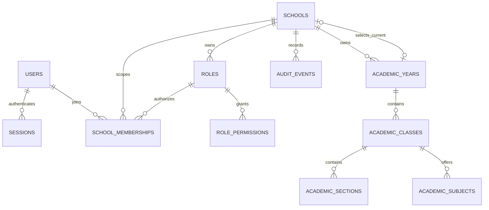

# School setup and academic foundation

This phase extends the existing React/Vite live workspace and Express/Typegoose backend. JWT cookies, server-controlled sessions, CSRF checks, membership authorization, and the response envelope remain in place. Demo state stays in the existing browser repository; live failures never fall back to it.

## Product flow

An Owner lands on **School setup**. The backend calculates the next incomplete step from saved records: profile, academic year, classes/sections, subjects, then review. Identity details are optional. Each successful save persists independently; refresh and sign-in resume from server state. Academic years and Classes also have independent settings tabs for subsequent administration.

Required readiness means:

- Address, city, a contact email or phone, and valid working hours/weekdays exist.
- The school explicitly selected an active academic year.
- That year has at least one active class.
- Every active class has at least one active section and subject.

Readiness is computed in a snapshot transaction, never stored as a client-controlled boolean. Archiving the last required record makes setup incomplete again. The overview reports foundation readiness; it does not simulate student/attendance/financial statistics. Future operational write APIs must independently enforce their relevant readiness prerequisites.

Profile settings include school/contact/location, timezone, working hours, optional website/affiliation/principal display text/motto, and a monogram with an accessible accent color. Code, registration slug, and school status remain platform-managed. Principal text is not a staff reference. Logo uploads and teacher assignment are deliberately deferred until safe asset storage and staff identities exist.

## Relationships and lifecycle



All identifiers are MongoDB ObjectIds. Academic classes, sections, and subjects retain explicit `schoolId` and `academicYearId`; children also retain `classId`. These references are immutable through these APIs and validated against the same tenant/year on every operation. The repeated scope keys support tenant-filtered indexed queries; they are assigned by the server, not accepted in bodies.

Years start as **draft**. Creating one does not change the current year. Selecting a draft activates it and updates the single school pointer atomically. An active year may become historical while remaining editable; only its name can change, not its dates. A non-current draft or active year may be permanently **closed**. Closed years and their academic structure are read-only. Date ranges cannot overlap, including boundary dates, across any states. No automatic calendar-driven switch occurs.

Classes, sections, and subjects use **active/archived** lifecycle with restoration. Names are NFKC-normalized, whitespace-collapsed and lowercased for uniqueness. Archived names remain reserved, encouraging restoration rather than duplicate identities. Archiving a class requires its active sections and subjects to be archived first. There is no hard-delete endpoint and no cascading removal. Future enrollment, promotion, attendance and reporting should reference these stable year-owned IDs; this phase does not create those modules.

## Concurrency and ownership

All configuration writes acquire the existing school authorization-version write lock within a transaction, then recheck active membership and the exact permission. This serializes school configuration/authorization changes and date-range checks. It trades per-school write throughput for predictable integrity during low-volume setup; unrelated schools can proceed independently. Every edit includes the displayed revision. Stale edits return `409 STALE_REVISION`; the UI retains the draft and asks the user to reload/reapply. Unique indexes reject concurrent duplicate names. Audits commit with their associated changes.

Owner assignment locks the active target account. Global disabling locks the account and each owned school and counts only Owners whose global account and school membership are active. Membership removal/reassignment uses the same school lock and usable-owner test. Transaction write conflicts retry through the existing transaction helper. Disabling or removing the last usable Owner returns `409 LAST_USABLE_OWNER` and does not revoke sessions or partially apply changes.

Super Admin has an explicit **Recover owner** action, not general school access. It requires an existing active target account, a 10–240 character reason, and **zero usable Owners**. It creates/restores an Owner membership, preserves school status, and writes school and platform audit events. Concurrent recovery attempts have one winner. A usable Owner must otherwise delegate access through normal school membership management.

## APIs and permissions

The complete backend contract is in `SCHOOL_SETUP_API.md` in the backend repository. Every school route requires a valid cookie session and active membership in an active school. Writes require CSRF/origin validation and the named manage permission. Super Admin status alone does not grant school access.

| Area               | Read permission          | Write permission                |
| ------------------ | ------------------------ | ------------------------------- |
| Profile            | `school.profile.view`    | `school.profile.manage`         |
| Academic years     | `academic-years.view`    | `academic-years.manage`         |
| Classes            | `classes.view`           | `classes.manage`                |
| Sections           | `sections.view`          | `sections.manage`               |
| Subjects           | `subjects.view`          | `subjects.manage`               |
| Onboarding summary | Active school membership | Derived only; no write endpoint |
| Owner recovery     | Platform Super Admin     | Platform Super Admin + CSRF     |

New Owners get all 15 catalog grants. The explicit versioned migration expands built-in Owner grants only. Custom roles are unchanged; their administrators must deliberately select new grants. Presets include dependent viewing grants for the associated screens. Delegation still requires that every requested permission belongs to the actor.

## Index choices

| Collection                               | Index                                                 | Purpose                                                           |
| ---------------------------------------- | ----------------------------------------------------- | ----------------------------------------------------------------- |
| `academic_years`                         | unique `(schoolId, nameKey)` where nameKey is string  | Normalized year names; legacy migration compatibility             |
| `academic_years`                         | `(schoolId, _id)`                                     | Tenant cursor pagination; school prefix also bounds overlap scans |
| `academic_classes`                       | unique `(schoolId, academicYearId, nameKey)`          | Name uniqueness per year, including archived classes              |
| `academic_classes`                       | `(schoolId, academicYearId, _id)`                     | Year-scoped cursor lists and readiness class scan                 |
| `academic_sections`, `academic_subjects` | unique `(schoolId, academicYearId, classId, nameKey)` | Child name uniqueness per class/year                              |
| Both child collections                   | `(schoolId, academicYearId, classId, _id)`            | Parent-scoped lists and readiness existence lookups               |
| Roles, memberships, audit events         | `(schoolId, _id)`                                     | Existing tenant cursor list queries                               |
| `schema_upgrades`                        | unique `(version)`                                    | Explicit schema migration marker                                  |

Existing identity, membership uniqueness, session TTL, and audit indexes remain. School profile is bounded embedded configuration, including one hours object with at most seven weekdays. Independent academic entities use separate collections. Growth is proportional to years × classes × sections/subjects; no unbounded browser lists are used. Lists return 50 records with an `_id` cursor. No production query-plan or load benchmark was run; index rationale is based on actual query shapes, not a claimed speedup.

## Deployment and migration

**Do not start the updated authenticated backend against an unupgraded database.** Startup now checks the migration marker and fails clearly if absent. It no longer creates indexes or backfills permissions during ordinary startup. Authentication still requires a replica set or sharded deployment. Atlas configuration is unchanged.

During a planned maintenance window with application writers stopped, take a database backup and run these commands in the backend repository using its configured environment:

```sh
./node_modules/.bin/ts-node commands/migrate-school-setup.ts --preflight
./node_modules/.bin/ts-node commands/migrate-school-setup.ts --apply
```

Preflight is read-only and reports sanitized categories for invalid dates, overlaps, duplicate normalized names, orphan years, or invalid current-year references. Resolve conflicts deliberately before applying. Apply backfills year keys/revisions/lifecycle, upgrades built-in Owner grants with audit events, creates declared indexes without dropping old ones, and records `school-setup-v1` only after success. Re-running safely resumes an interrupted application or verifies indexes after completion. Run one migration process at a time. Large installations should budget index-build time and per-school transaction duration; no remote performance measurements were made. Index-build failures leave the marker absent and block startup until resolved.

No production/Atlas connection or migration was executed during implementation. Migration tests ran only on temporary owned local replica sets. No environment values were changed. Live frontend uses `VITE_APP_MODE=live`; demo continues with `VITE_APP_MODE=demo` and needs a Vite restart when environment files change. Existing JWT/MongoDB/cookie/origin configuration remains required. Never put secrets in `VITE_*`.

## Implementation map

Frontend:

- `src/features/setup/`: onboarding/review, profile editor, year lifecycle, classes/children, revision-aware forms, shared load/confirmation/pagination, responsive styling and focused tests.
- `src/services/schoolSetupService.ts`: validated DTOs, scoped responses and actual registered endpoint methods.
- `src/services/schoolProfileService.ts`, `apiService.ts`: profile write contract and safe domain error messages.
- `src/features/settings/LiveSchoolProfile.tsx`: persisted fields, edit action, accessible monogram.
- `src/features/live/LiveSettings.tsx`, `schoolNavigation.ts`, `LiveApp.tsx`: permission-aware tabs and unsaved school-switch/sign-out protection.
- `src/services/schoolAccessService.ts`: new permission labels.
- `src/features/platform/OwnerRecovery.tsx`, `PlatformDashboard.tsx`, `src/services/platformService.ts`: explicit owner recovery UI/API integration.
- Existing Modal, Panel, Button, Badge, `useRemote`, API cache/session handling and `useDraftGuard` are reused.
- `tests/live-api.e2e.ts`: existing live regressions plus complete persisted setup, save failure, resume and school-switch coverage.

Backend:

- `src/api/models/foundation.models.ts`, `academic.models.ts`: profile/year revisions, academic entities, indexes and recovery audit reason.
- `src/api/controllers/requests/schoolSetup.request.ts`: strict validated bodies; unknown properties rejected.
- Controllers `academicYear`, `classStructure`, `sections`, `subjects`; updated `schoolProfile` and `platform`; controller registration updated.
- `src/api/repositories/academic.repository.ts`: scoped resource resolution and bounded cursor queries.
- Services `profileWrite`, `academicYear`, `classStructure`, `schoolSetup`, `schoolWrite`, `setupRules`, `ownership`: rules, transactions, explicit DTOs and audit boundaries.
- Existing authorization, onboarding, platform and schoolProfile services: usable-owner locking and updated profile contract.
- `src/security/permissions.ts`, error handler: capability catalog and sanitized domain errors.
- `src/database/migrations/schoolSetupV1.ts`, `commands/migrate-school-setup.ts`, foundation loader and database configuration: explicit migration, startup verification, disabled automatic schema mutation.
- `src/security/schoolSetup.integration.test.ts`: isolated persistence/concurrency/migration tests; affected existing tests updated to the new contract.
- `src/test/prepareFoundation.ts` and browser fixture: explicitly prepare only the isolated test schema.

> Follow-up: [Bulk school onboarding](bulk-onboarding.md) now implements staff/student imports, enrollment, assignments and bulk structure. The limitations and verification below describe the earlier foundation phase.

## Limitations and next phase

No uploads, staff identity/teacher assignment, students, enrollment, attendance, fees, payroll, exams, documents, or communications were added. Subjects currently belong to a class within one year, not to a global reusable curriculum catalog. Changing school names does not rewrite historical audit records. Ordinary list pages include archived records and expose their status; server-side search/filtering can be added when record volume warrants it.

The next phase should establish staff identities and year/section enrollment, with validated relationships and historical transfer/promotion semantics, before attendance or assessment. Add relevant operational readiness guards to those future APIs. Real deployment migration and a staging smoke test remain operator tasks.

## Verification record

All database tests below used the existing isolated MongoDB fixture, which starts and cleans up its own local replica directory. No configured database URI was used.

| Repository / check          | Command actually run                                                                                                                                                                       | Result                                                                              |
| --------------------------- | ------------------------------------------------------------------------------------------------------------------------------------------------------------------------------------------ | ----------------------------------------------------------------------------------- |
| Backend typecheck           | `./node_modules/.bin/tsc --noEmit --incremental false`                                                                                                                                     | Passed                                                                              |
| Backend complete test suite | `./node_modules/.bin/jest --runInBand`                                                                                                                                                     | 21 suites, 142 tests passed                                                         |
| Backend lint                | `./node_modules/.bin/eslint . --ext .ts` and build's `yarn lint`                                                                                                                           | Passed, no lint exceptions                                                          |
| Backend production build    | `yarn build`                                                                                                                                                                               | Passed                                                                              |
| Frontend typecheck          | `./node_modules/.bin/tsc --noEmit`                                                                                                                                                         | Passed                                                                              |
| Frontend lint               | `./node_modules/.bin/eslint src`                                                                                                                                                           | Passed, no warnings                                                                 |
| Frontend unit tests         | `./node_modules/.bin/vitest run`                                                                                                                                                           | 38 files, 237 tests passed                                                          |
| Frontend production builds  | `npm run build` (demo configuration), `VITE_APP_MODE=live npm run build`                                                                                                                   | Both passed                                                                         |
| Live browser integration    | `PLAYWRIGHT_CHROME_PATH=/usr/bin/google-chrome ./node_modules/.bin/playwright test --config playwright.live.config.ts`                                                                     | 12 passed, including the complete setup workflow and automated accessibility checks |
| Demo browser regressions    | `PLAYWRIGHT_CHROME_PATH=/usr/bin/google-chrome ./node_modules/.bin/playwright test tests/demo.e2e.ts tests/settings.e2e.ts tests/accessibility.e2e.ts tests/header-fit.e2e.ts --workers=2` | 14 passed, 1 pre-existing stale-navigation test failed                              |
| Working tree whitespace     | `git diff --check` in both repositories                                                                                                                                                    | Passed                                                                              |
| Environment exclusion       | `git check-ignore .env` in both repositories                                                                                                                                               | Both ignored; no env edits                                                          |

The demo failure is `tests/demo.e2e.ts:17`: it waits for the old **Classes & sections** navigation link. `git show HEAD:tests/demo.e2e.ts` contains that same locator, while `git show HEAD:src/components/layout/AppShell.tsx` already lists **Academics** and no such link. Both files are unchanged by this phase. The test was neither skipped nor weakened. The other demo checks cover profile persistence, settings, navigation layout, accessibility, browser persistence, and mobile overflow. The entire unrelated browser suite was not run.

New backend coverage includes profile revision conflicts and audit rollback, real date validation and lifecycle, normalized duplicate names, current-year concurrency, readiness invalidation on archive, parent/reference isolation across two schools/years/classes, forbidden arbitrary teacher fields, pagination/empty results, owner-disable/suspension concurrency, explicit audited recovery concurrency, and idempotent preflight/migration behavior with custom grants preserved. Existing authentication, CSRF, error sanitization, and session-revocation regression tests also passed.

During development, a multi-document audit insert required `ordered: true` within a Mongoose transaction; the recovery test caught and verified the correction. An automated accessibility check caught the monogram's contrast; text now chooses black or white by relative luminance on the selected accent. Old read-only/permission-count assertions were updated to the actual contracts, retaining their sanitization and authorization checks. A browser run interrupted by development hot reload was discarded and rerun after source edits stopped.

Final live verification completed with 12/12 passing after the owner-protection message assertion was updated. This covered real cookie login and CSRF, platform school/account creation, owner setup persistence, refresh and re-login, API save failure without lost draft or demo fallback, permissions, stale school requests, school switching, responsive layout and automated accessibility. No live source edits were made during that final run.
